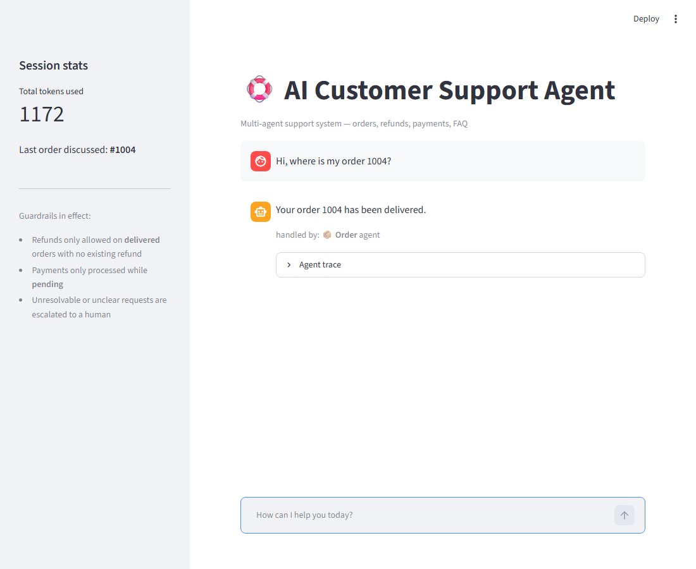
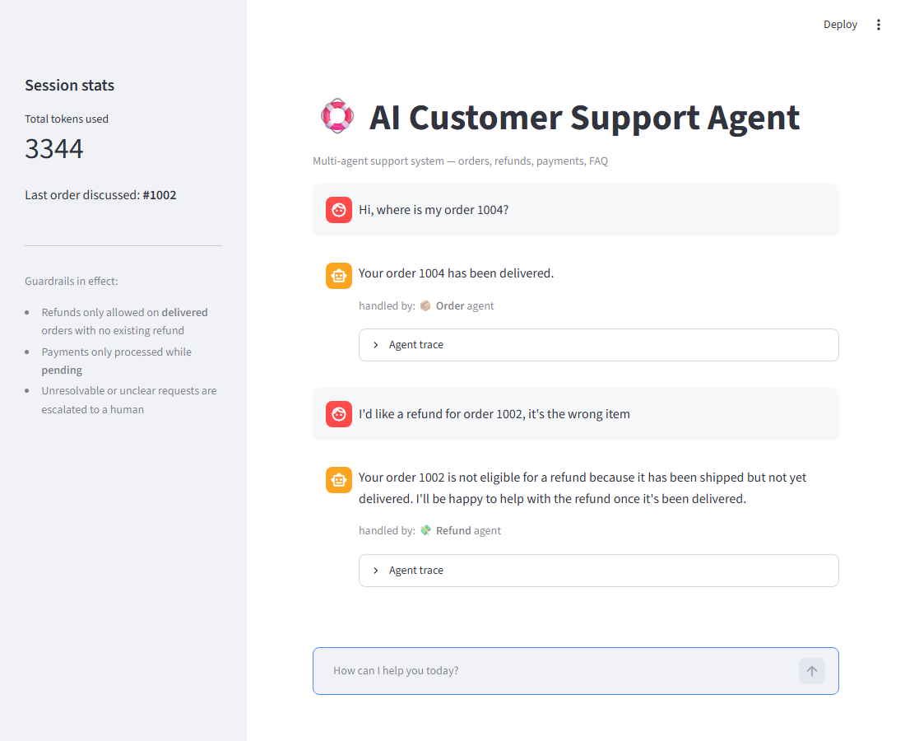
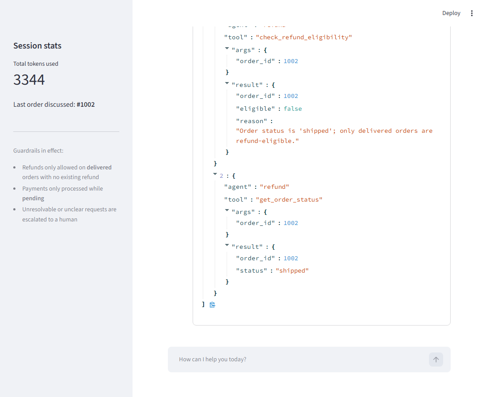
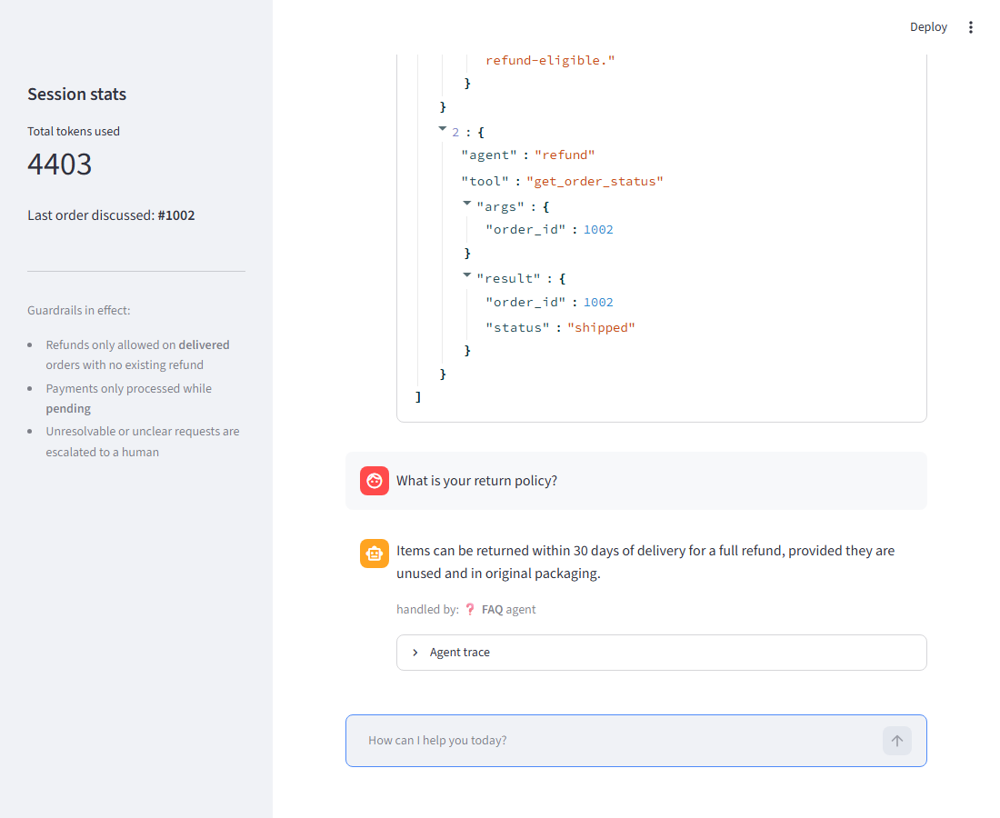
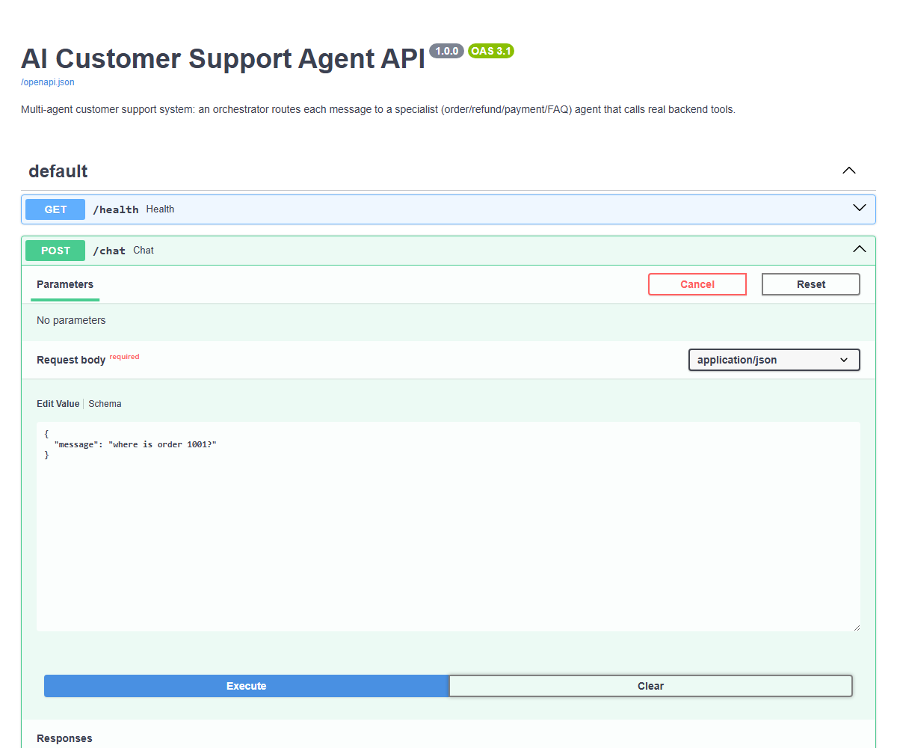
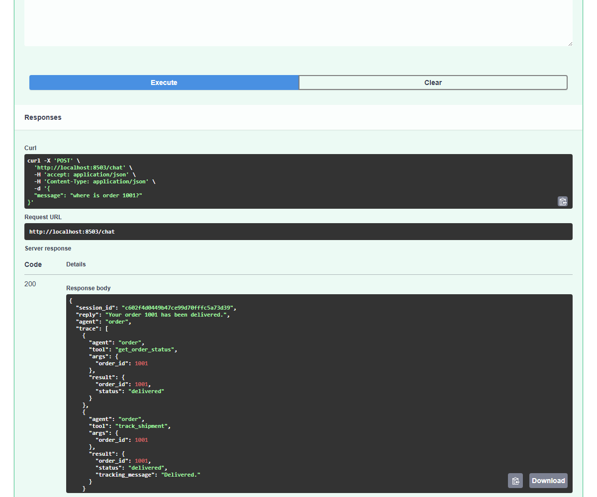

# AI Customer Support Agent (Multi-Agent)


A multi-agent customer-support system for an e-commerce store. An orchestrator
routes each request to a specialist agent (orders, refunds, payments, FAQ) that
calls real backend tools to resolve it — with deterministic task intake,
bounded tool execution, typed failures, approval boundaries, and observable runs.

## 选序消费工作空间

Streamlit 界面提供六个通过侧栏连接的页面：

- **工作台**: start or continue a conversation, query active orders, and explore shopping scenarios.
- **商品发现**: search 60 fictional demo products across headphones, keyboards, and USB-C hubs; filter by budget and stock; compare two or three products.
- **订单与售后**: browse the existing seed orders, inspect stored shipment events, and pass an order into the assistant. Payment/refund writes require a separate confirmation.
- **任务记录**: view the latest 100 actual run snapshots saved in SQLite, including results and historical statuses. Interrupted tasks retain checkpoints and can be resumed.
- **我的偏好**：明确确认保存预算、品类和特征，查看版本、更新或忘记；新对话沿用当前偏好档案，当前需求的明确条件优先。
- **Agent Lab**: inspect actual events, tool parameters/results, task plans, dependencies, verified outcomes, budgets, token usage, latency, and terminal reasons for a selected run.

Product discovery and comparison also work through `/chat`, for example
`推荐通勤降噪耳机，预算 500 元以内` and `对比商品 P1101 和 P1102`.
These explicit requests use the deterministic path without model calls.

All brands, prices, stock, customer accounts, and shipment events are **demo data**.
The workspace displays a shared local dataset rather than authenticated customer accounts;
payments and refunds only mutate the demo SQLite database. Product/order pages read
database records rather than embedding sample results in the frontend.
New tables are added automatically without resetting existing orders, payments,
refunds, or modified product stock. Starting a new conversation leaves archived runs intact.
Conversation messages and pending approvals are saved in SQLite. The browser URL carries the conversation ID so refreshing or restarting the service restores the same context. Interrupted tasks can resume from the workbench. See [runtime and recovery](docs/agent-runtime.md) for consistency guarantees and limits.

工作台可启用“允许助手按执行结果调整选购步骤”：由模型理解目标并在每次观察后选择下一步，可调整搜索、比较候选、澄清或提交推荐；执行层重新核验价格、库存和硬约束，失败结果交回模型。选购与订单查询等复合请求逐项目标核验，单项完成不会冒充全部完成；最终完成前再次刷新推荐商品。未配置模型时明确报告自主模式未执行。运行中支持补充要求、取消后续步骤和排队追问。异步 API 使用 `POST /runs`，持久事件通过 SSE 支持断线续传；已提交业务操作在取消和恢复后仍保留证据。

详见 [自主计划](docs/adaptive-planning.md) 与 [会话控制、上下文及偏好](docs/session-control-memory.md)。真实评测入口 `eval/run_live_eval.py` 包含固定 20 项任务、开发/测试各十项、默认三次重复；未配置模型时返回 `NOT_RUN`。当前仅完成离线验证，未调用真实模型。

## Live demo

**▶️ Live app:** https://support-agent-htg6lfc8qdjeez9bhx8b9o.streamlit.app/
(free-tier hosting — if it shows "app went to sleep," click "Yes, get this app
back up," it wakes in under a minute)

## Screenshots

| Order lookup | Guardrail refusal |
|:---:|:---:|
|  |  |

| Guardrail enforced at the tool level | FAQ answer + session stats |
|:---:|:---:|
|  |  |

The right-hand pair shows the actual mechanism: `check_refund_eligibility`
returns `"eligible": false` for a shipped (not delivered) order, so
`initiate_refund` never even attempts the refund — the rule is enforced in
the tool's code, not just requested in a prompt.

| FastAPI interactive docs (`/docs`) | Real `/chat` request + response |
|:---:|:---:|
|  |  |

Same orchestrator, different front door: this is the identical order-lookup
request from the screenshot above, but made directly against the REST API
instead of the chat UI — same reply, same tool trace, same backend.

## What it does

- Understands natural-language support requests
- Routes to the right specialist agent (LangGraph orchestration)
- Calls tools that read **and modify** a backend (order status, refunds, payments)
- Remembers context across turns (e.g. "refund it" resolves to the last order discussed)
- Enforces guardrails at the tool level (e.g. refunds only on delivered orders)
- Uses a zero-token deterministic fast path for clear order, tracking, refund-eligibility, payment-status, and policy requests
- Separates model failure, unsupported intent, missing information, business rejection, and explicit human escalation
- Requires approval before payment/refund mutations, carries the pending action in the session, and supports explicit confirm/cancel responses
- Shows a run-linked event trace: intake, route decision, model call, tool call/result, errors, and terminal reason
- Builds bounded compound task plans, dispatches steps to specialists, and checks each goal against real observations
- Persists conversation state, approvals, checkpoints and an idempotent tool ledger; atomic local writes survive interruption
- Tracks model/tool/time/token budgets; unknown provider token usage remains unknown
- Exposes the same orchestrator over a **FastAPI** REST endpoint, not just the chat UI
- Ships with a **routing evaluation harness** that measures LLM classification accuracy on a curated dataset, separate from unit tests

## Tech

LangGraph multi-agent orchestration · Configurable Model Gateway
· SQLite backend (SQLAlchemy) · Streamlit · FastAPI · pytest

## Architecture

```
Streamlit UI / FastAPI
        |
Durable conversation + request deduplication
        |
Task intake: direct plan / structured compound intake / LangGraph specialist
        |
Bounded steps + dependencies + approval preparation
        |
Unified ToolExecutor: schema, budgets, policy, ledger, deadlines
        |
SQLite business records + checkpoint + atomic local writes
        |
Goal verification + terminal result + unique conversation reply
```

## How it works

1. A deterministic Task Intake layer extracts intents, order IDs, missing
   slots, unsupported requests, and explicit escalation requests. Clear tasks
   use a bounded read-only plan; ambiguous compound tasks use structured model intake, and simple ambiguous tasks fall back to LangGraph.
2. On the model path, the matching specialist agent decides which tool(s) to call and with what
   arguments (Gemini/Groq/OpenAI/OpenAI-compatible tool-calling), then turns the tool result into a
   natural-language reply.
3. Tools read from and write to a SQLite database — refunds and payments are
   real state changes, not simulated text.
4. Guardrails are enforced in the tools themselves (not just the prompt): for
   example `initiate_refund` always re-checks eligibility before acting, so
   an LLM can't talk its way around the rule.
5. A model or tool failure is recorded with a stable error code and terminal
   reason. It is not mislabeled as a successful human escalation, and the
   whole graph is not replayed after a tool has already completed.
6. SQLite conversation memory tracks the last order discussed and missing slots, so follow-up messages
   like "refund it" or a supplied order number resolve across agent switches and service restarts.
7. The durable entry point serializes each conversation. Successful tool results and model decisions
   are reused on explicit recovery. Local payment/refund changes and their ledger entries commit together.

## Run locally

1. `python -m venv venv` and activate it
   (`.\venv\Scripts\Activate.ps1` on Windows, `source venv/bin/activate` on macOS/Linux).
2. `pip install -r requirements.txt`
3. Copy `.env.example` to `.env`, then configure at least one supported model
   provider. Gemini remains the zero-migration default; OpenAI, Groq and any
   OpenAI-compatible endpoint are also supported.
4. `python -m src.backend.seed` — creates and seeds the SQLite database.
5. `streamlit run app.py`

## Run the API (FastAPI)

```
uvicorn api:app --reload
```

Then open interactive docs at http://localhost:8000/docs. Example flow:

```bash
curl -X POST http://localhost:8000/chat \
  -H "Content-Type: application/json" \
  -d '{"message": "where is order 1001?"}'

# reuse the returned session_id to keep conversation memory across turns
curl -X POST http://localhost:8000/chat \
  -H "Content-Type: application/json" \
  -d '{"message": "refund it, it arrived broken", "session_id": "<id from above>"}'
```

Every request is logged as structured JSON (method, path, status, latency).
The Streamlit UI and the API both use `src/durable.py` and `src/orchestrator.py`, so the
agent logic is written once and consumed by either a human (UI) or a machine
(API).

运行状态接口：

- `GET /health`：仅检查 API 进程是否存活。
- `GET /ready`：检查数据库连通性和模型配置，失败时返回 `503`；不会触发模型调用或费用。
- `GET /models/status`：返回脱敏后的 Provider、模型、降级槽位、熔断健康状态和最近调用状态，不返回 API Key。
- `GET /runs/{run_id}/trace?session_id=...`：把底层事件投影为统一时间线、完整性检查和运行摘要。

## Tests

```
pytest
```

Tests cover: deterministic Chinese/English task intake, compound
intent parsing, clarification and unsupported requests, run-linked events,
tool validation/budgets/deduplication, failure semantics, approval boundaries,
the order-1004 Chinese regression, every SQLite business tool, specialist
agent loops, conversation memory, FastAPI endpoints, catalog constraints and
comparison, shipment events, persisted run archives, model-path confirmation,
and Streamlit workspace interactions.

## Evaluation

A routing evaluation harness measures whether the router LLM classifies
realistic (and deliberately tricky) customer messages correctly — this is
different from the unit tests, which only check the graph wiring with a
mocked LLM:

```
python eval/run_eval.py --dry-run   # validates the dataset, no API calls
python eval/run_eval.py             # calls the real LLM, reports accuracy
```

The original 21-scenario dataset (`eval/eval_dataset.json`) is a live router benchmark. Its earlier recorded score is not a task-success measurement for the current runtime; run it with your configured provider to obtain current routing accuracy.

固定离线任务集另有可审计的 `baseline-v1`。CI 会执行以下门禁，校验数据集指纹、60/60 任务、71/71 轮次以及模型/工具调用上限；它只用于回归保护，不宣称实时模型质量：

```bash
python eval/run_task_eval.py --gate
```

## Docker

```
docker build -t support-agent .
docker run -p 8501:8501 -e GEMINI_API_KEY=your_key support-agent
```

## Deploy (Streamlit Community Cloud)

1. Push this repo to GitHub.
2. On https://share.streamlit.io, create an app from the repo, main file `app.py`.
3. In the app's **Secrets**, add:
   ```
   GEMINI_API_KEY = "your_key_here"
   GROQ_API_KEY = "your_key_here"   # optional fallback
   ```
   Never commit the real key — `.env` is git-ignored.
4. That's it — the SQLite file isn't committed to the repo, but `src/tools.py`
   auto-seeds the database on first import if it's empty, so a fresh
   deployment works with no extra startup step.

## Cost

成本取决于所选 Provider 和模型。清晰业务请求优先走确定性执行路径，不调用模型；模型路径会记录可用的 Token 用量，但不会把未知用量伪装为零。请在 Provider 控制台配置预算与限额。

## 模型接入

Model Gateway 使用英文配置标识，运行时提示与产品内容保持中文。清晰、可确定的业务请求仍会走零 Token 快速路径；只有需要理解、规划或工具决策的请求才调用模型。

网关会统计各 Provider 的连续瞬时失败。默认连续失败 2 次后熔断 30 秒，期间自动跳过该候选；可通过 `LLM_CIRCUIT_FAILURE_THRESHOLD` 和 `LLM_CIRCUIT_COOLDOWN_SECONDS` 调整。

最短配置示例：

```dotenv
# 保持现有 Gemini 接入
LLM_PROVIDER=gemini
LLM_API_KEY=your_key
LLM_MODEL=gemini-2.5-flash

# 或使用 OpenAI 官方 API
LLM_PROVIDER=openai
LLM_API_KEY=your_key
LLM_MODEL=gpt-4.1-mini

# 或使用任意 OpenAI-compatible 服务
LLM_PROVIDER=openai_compatible
LLM_API_KEY=your_key
LLM_MODEL=your_model
LLM_BASE_URL=https://provider.example.com/v1
```

- `LLM_PROVIDER`：`auto`、`gemini`、`groq`、`openai` 或 `openai_compatible`。
- `LLM_API_KEY` / `LLM_MODEL` / `LLM_BASE_URL`：主 Provider 的统一配置；兼容服务必须同时提供三项。
- `LLM_FALLBACK_PROVIDERS`：逗号分隔的降级顺序，例如 `groq,gemini`。认证错误不会跨 Provider 重试，限流、超时和服务不可用才会降级。
- `LLM_MAX_ATTEMPTS` / `LLM_REQUEST_TIMEOUT`：有上限的尝试次数和单次超时。
- `LLM_ROUTER_MODEL`、`LLM_PLANNER_MODEL`、`LLM_AGENT_MODEL`、`LLM_FINAL_RESPONSE_MODEL`：按职责覆盖主 Provider 的模型名。
- 原有 `GEMINI_API_KEY(S)`、`GEMINI_MODEL`、`GROQ_API_KEY`、`GROQ_MODEL` 继续兼容；`LLM_PROVIDER=auto` 会按 Gemini、Groq、OpenAI、OpenAI-compatible 的顺序发现配置。

API Key 不会出现在状态数据、事件或日志元数据中。完整模板见 `.env.example`。

接入后可先做零费用配置检查，再执行一次真实请求：

```bash
python scripts/check_model.py --config-only
python scripts/check_model.py --purpose agent
python scripts/check_model.py --purpose agent --check-tools
```

最后一条会验证工具调用协议，适合确认 OpenAI-compatible 服务是否真正支持当前 Agent 所需的 tool calling。


## Fixed task evaluation

```bash
python eval/run_task_eval.py --dry-run
python eval/run_task_eval.py --output output/task-eval.json
```

The suite has 60 independent tasks / 71 turns across Chinese/English order queries,
compound goals, follow-up context, clarification, human requests, business rejection,
shopping, approval workflows, and injected model faults. Every task gets a fresh demo
SQLite database. The judge checks physical backend observations and actual business
state changes, so a fabricated success trace cannot pass. Network access is disabled;
scripted model responses exercise runtime behavior, not live model quality. Reports
include task success, actual model/tool counts and latency. Fake token usage is marked
synthetic and monetary cost remains unknown. No unmeasured old-version improvement is claimed.

For durable API request retries, supply a stable `request_id`. Read saved state with
`GET /conversations/{session_id}` and restore a task with
`POST /runs/{run_id}/resume`, body `{"session_id":"..."}`. Approval clients should echo
the current `action_id` so stale UI confirmations are rejected.

### 原始需求审查与自主专项评测

自主模式在接受目标前独立核对用户要求是否漏项、约束语义是否被反转，在最终完成前复核原始需求和证据。审查失败反馈模型受限修复，不能降级为成功；这仍是模型审查，不保证模型不会误判。FAQ必须返回有政策 ID/版本的依据，无依据不算完成。人工请求只登记持久的本地演示工单，尚未接入真人及通知。

运行 `venv/bin/python eval/run_adaptive_eval.py --dry-run` 校验独立的20项自主任务集；通用 `auto` 结果和 `adaptive` 专项分开报告。未配置模型时真实执行为 `NOT_RUN`；当前未调用真实提供方。详见 [自主计划与审查边界](docs/adaptive-planning.md)。
