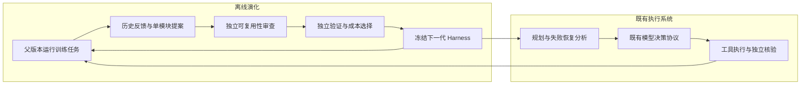

# 规划与失败恢复自进化设计

## 本次实现的边界

以 RRSI（arXiv:2609.24972v3，2026-10-04）为演化规则参考，沿用现有 Adaptive Runtime，通过 planning 槽位装配两个可独立演化的模块：规划与失败恢复。第一版允许改变模块的分析指令、触发时机和是否增加结构化分析调用，不执行模型生成的 Python，不允许修改 Kernel。它是受限 Harness 演化，不是完整复现论文的开放代码修改空间。

必须保持的不变量：

- 所有模型调用经过 Model Gateway 和同一 Run 的预算、模型账本；建议不直接执行工具。
- 原始目标、独立审查、确认、权限、终止、幂等和工具执行边界不可由候选修改。
- 模块产物不可变并绑定指纹，恢复必须使用同一程序；分析结果与模型游标一起检查点持久化。
- 每轮只改变一个模块；另一模块必须逐字段保持不变。
- 学习只见 dev 的脱敏轨迹摘要；validation 只提供选择反馈；test 在冻结最终产物之后单独执行。
- 所有候选与拒绝结果落盘，报告缺失、成本未知或环境漂移不能产生接受结果；candidate 不自动晋升。
- 不把测试替身轨迹当成真实模型收益证据。

## 预期行为

规划模块可在初始目标理解前、目标建立后或每次决策前运行。恢复模块识别执行错误、空观察、决策拒绝等运行状态，选择内联诊断指令或额外的结构化分析步骤。分析输出包含诊断、备选行动与建议，仅供既有决策器选择；决策器仍输出原有协议并接受原有核验。

学习器运行父版本，汇总任务成败、行动序列、失败类别、目标完成情况以及模块触发信息，提出修改。独立 Critic 检查是否记忆任务或放松硬约束。候选在独立 dev 分组运行；选择器检查历史最好成绩下限、成功率、重复稳定性、安全、协议与 Token 成本。胜出版本成为下一轮父版本。

## 组件如何参与执行



`HarnessProgram` 有 `planning` 和 `recovery` 两个模块。每个模块包含 `mode`、`trigger`、`instruction`。`inline` 在原决策调用中消费策略；`deliberate` 在原调用之前增加一次结构化分析，输出诊断、最多三个替代方向和建议下一步。没有新增工具权限或第二套执行器。

规划触发可选首次目标理解、目标已建立后、每次决策。恢复触发可选全部失败、工具失败、空结果或决策拒绝。`after_goal` 表示目标建立后的每次决策，并非只触发一次。触发条件是状态分类，不匹配具体消费问句。LLM 自行根据原始请求及观察生成诊断和行动建议，最终仍由原有 `Decision` 协议和 Runtime 选择、校验、执行行动。

准备结果按程序指纹、原始请求、目标修订、执行映射版本、目标账本、反馈及执行步骤绑定。建议与模型游标一起写入原 Adaptive 检查点。崩溃发生在模型完成后、外层状态保存前时，原模型账本可复用相同输入结果；目标变化则使绑定失效。预算只剩两次模型调用时跳过独立分析，为决策与核验留出空间；不保证复杂任务在剩余预算内一定能完成。

`rrsi_module_applied` 保存模块、模式、触发原因、状态和产物指纹；`rrsi_policy_prepared` 记录本次准备的绑定。分析模型调用使用 `rrsi_planning` / `rrsi_recovery` purpose。原始事件可经现有 Run Inspector 事件视图查看，本版没有新增专用演化 UI。

## 研究依据与实际差异

主依据：[RRSI 论文 v3](https://arxiv.org/html/2609.24972v3)，[Google Research 官方实现](https://github.com/google-research/rrsi/tree/be50316e1db05914068a973f322770ef08ed7ba1)。核对的版本是 `be50316e1db05914068a973f322770ef08ed7ba1`；相关实现为 `rrsi/schedule.py`、`rrsi/selection.py`，本项目独立实现对应调度与选择公式，无新增外部依赖。

RRSI 试图避免有限 evolve 集上的过拟合：提案端限制每次独立修改数量并参考历史；选择端审查泄漏，结合历史最好成绩、噪声容差及策略 Token 成本进行保留。论文结果来自作者的其他任务与模型，不能当成 LingCart 收益。

[ModularRSI](https://arxiv.org/abs/2609.14857) 提供模块化分析的设计参考。本版保留按样本与重复编号标记的成败轨迹，可以对照同任务不同重复的成败；没有实现其完整跨任务缺陷聚合器、模块代码合并或基准无交叉的独立演化数据集，因此不称为 ModularRSI 复现。

| 机制 | 本版实现与限制 |
| --- | --- |
| 退火编辑预算 | 按 RRSI 余弦公式；逐字段计数，不是代码 AST 编辑计数 |
| 历史反馈 | 保留全部候选、父指纹、假设、程序与验证结果；重复结构拒绝 |
| Critic | 独立模型调用加严格 schema 与策略文本校验；不是自由文本安全性的证明 |
| 成本选择 | 历史最好下限和两段成本公式；成本必须可测，缺失则拒绝 |
| 非补偿保护 | 安全、协议不得违规，首次成功率和重复稳定性不得退化 |
| 结构简化 | 提案可把 deliberate 改回 inline、缩短指令；未实现独立 Pruner 消融搜索 |
| 结构新颖性 | 没有开放新增工具/子智能体，故不给新颖性奖励 |
| 演化空间 | 模块提示、触发策略和分析调用控制；不支持任意 Python 自修改或模型权重训练 |
| 噪声 | 默认容差零，尚无独立噪声标定；小样本成本变化可能是随机波动 |

该实现不是“模型改进自身学习器”的元递归，而是论文所说的 Agent 系统级 RSI：改进当前 Harness，再用改进后的系统获得下一轮反馈。

## 运行与产物

仅校验、不调用模型：

```bash
venv/bin/python -m eval.run_rrsi_eval
venv/bin/python -m eval.run_rrsi_eval --spec research/experiments/rrsi-planning-v1/evolution-spec.json
```

有界真实恢复 smoke（输出目录必须尚不存在）：

```bash
venv/bin/python -m eval.run_rrsi_eval --live --heldout \
  --spec research/experiments/rrsi-recovery-v1/smoke-spec.json \
  --output-dir research/rrsi/recovery-smoke-01
```

规划实验替换为 `rrsi-planning-v1` 的配置。可用 `--seed` 指定已冻结产物；逐模块组合时先冻结恢复产物，再用它作为规划实验 seed，规划实验不得改动恢复字段。组合效果仍需另做对照，不能累加两个实验的收益。

每次实验保存 spec、seed、动态 Profile、程序文件、原始模型提案、Critic、训练/验证报告、每轮选择记录、retained 与最终报告。指定 `--heldout` 才在演化完成后生成 test 契约并执行留出对照；学习器不接收该结果。目录以排他方式创建，中断后保留已有证据，本版不自动续跑离线搜索；新实验必须使用新目录。在线任务恢复与离线演化续跑是不同能力。

正式配置每个训练、验证、测试分组各三题、三次重复，三轮、每轮两个候选；smoke 每组一题、一次重复，两轮、每轮一个候选。均使用固定 `pg_challenge_tasks.json`，它是本项目已有数据，不能称作全新未接触的外部泛化基准。评测执行真实模型和本地隔离业务数据库，不调用真实商户支付或退款。

先关注三个问题：模块是否真正被触发；修改是否改变决策行为；留出任务是否在相同预算内改善。即使 dev 接受候选，也保持 `candidate`，不进入普通产品入口，不自动晋升。
