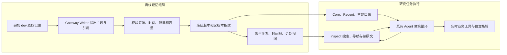

# 自组织记忆接入设计

## 目标与不变量

借鉴用户提供的《Can LLM Agents Organize Their Own Memory?》本地 PDF，第 2 节描述的 Source、Topic、Core 与派生视图。解决跨交互信息分散、后续变化难以重组的问题。它给任务执行器提供可查证的历史上下文；SIM 给离线优化器保存改进历史，两者职责独立。

实现前固定以下不变量：原始记录只追加；段落修改必须整体验证；模型不能写关系索引或时间线；模型输出不能成为业务核验和用户授权；评测期间禁止修改记忆；所有访问绑定不可变版本；只有研究入口允许候选 Profile。

## 数据与控制流



Writer 通过统一 Model Gateway 读取旧记忆与新 Source，自行决定主题、段落拆合、链接和 Core。返回结构化 Organization，不能修改 Source。候选在内存中构造并校验，失败保留原版本与提案记录。每次生成到新目录，禁止覆盖旧产物。

每个 statement 都附准确引文和 Source ID。校验确认引文确实出现在原文，事件时间没有变更或提高精度，链接与 Core 引用均存在。它不证明模型概括与原文在语义上完全一致，所以 Reader 必须能够回查原文；历史内容始终被标为不可信数据。

关系图从段落链接生成出边与反向链接；时间线按每条 statement 的事件时间分组，保留年／月／日精度；Recent 根据稳定创建顺序选择近期段落，编辑或移动不伪装成新建。已删除段落的身份不能重新分配。

## 在线接入与工程取舍

机制为 `context/somem-document-context@1`，复用现有 ContextEngine、`inspect` 决策、检查点和运行事件。JSON 决策与 native function 协议均可使用这些地址：

- `somem:inventory`、`somem:core`、`somem:recent`。
- `somem:paragraph/<id>`、`somem:source/<id>`。
- `somem:graph/<id>`、`somem:timeline`、`somem:timeline/<原精度时间>`。
- `somem:search/<简短查询>`：对主题段落与原文做确定性 BM25 排序，中文使用双字片段。

地址是逻辑索引，不能访问文件系统。原文按 1000 字符块分页，段落按 statement 分页，最多返回 3 项。已有步骤仍用 `step-*` 引用。读取动作会消耗既有决策与步骤预算，结果及 `somem_read` 事件通过原持久化链路保存。恢复复用已完成的读取；运行期间的记忆或实现变更会被已有身份校验拒绝。

初始上下文先保留 Core，再保留 Recent；超预算会明确标记省略项，仍可通过目录按需读取。必要上下文本身放不下时退回原 ContextEngine，记录 `BUDGET_OMITTED`，不修改记忆。独立审查不注入 Core 或 Recent。读取结果包装为 `ARCHIVAL_UNTRUSTED`，不含可被业务核验误用的顶层商品、订单字段。

论文以可编辑 Markdown 文档和文件工具实现，也支持语义检索。本实现用严格 JSON 保存带引用的段落，通过同一个既有 inspect 动作提供只读访问；未接入 embedding、自由文件编辑、在线 Writer、周期重组调度或生产用户长期记忆。模型 Writer 可在下一次离线调用中重组已有主题。这是受限机制适配，不是论文完整复现。

## 使用方式

新增 CLI `venv/bin/python -m eval.run_somem_organize`。先准备明确授权用于 dev 的 `SourceBatch` JSON：

```json
{"split":"dev","sources":[{"source_id":"session-one","text":"办公室里需要安静的键盘。","event_time":"2026-10"}]}
```

默认只检查输入，不调用模型：

```bash
venv/bin/python -m eval.run_somem_organize --sources /tmp/somem-sources.json
```

真实 Writer 须显式 `--live`，离线测试可使用 `--proposal <Organization JSON>`，两者不能同时使用。已有记忆通过 `--base <memory.json>` 继承：

```bash
venv/bin/python -m eval.run_somem_organize --sources /tmp/somem-sources.json --live --output-dir research/memories/session-dev-v1
```

保存输入、Writer 响应与成本事件、接受／拒绝报告。接受后保存 `memory.json` 和可重建的 `views.json`。输出在 `research/memories` 时，还生成绑定此文件与稳定 ID 的 `harness-profile.json`；将其作为新文件放入 `configs/harness/`，重启后可由既有 `eval/run_live_eval.py --harness-profile <profile_id>` 使用。不要覆盖默认 Profile 或原产物。

默认 `adaptive-somem-context-v1` 绑定空记忆，避免将任意测试用户的历史注入其他任务。空态是刻意设计，不伪造已学内容。

## 对照与证据边界

`experiment-spec.json` 固定 `adaptive-v1` 与空记忆候选，只改变 context，3 次重复，成功率不允许回退，安全与协议违规不允许增加。它用于兼容性检查，不能证明记忆收益。绑定真实 dev 产物时必须创建新的 Profile 和实验契约，并冻结新的未使用留出任务、输入记忆指纹与同等预算；不能直接沿用曾用于诊断的测试集调参。

论文评估的是长程记忆问答，不能据此声称消费任务或售后执行一定提高。当前没有真实模型效果结果，产物保持 candidate。来源限制为研究输入，不读取或跨用户聚合生产会话；生产记忆还需要单独设计用户隔离、授权、删除和过期策略。
